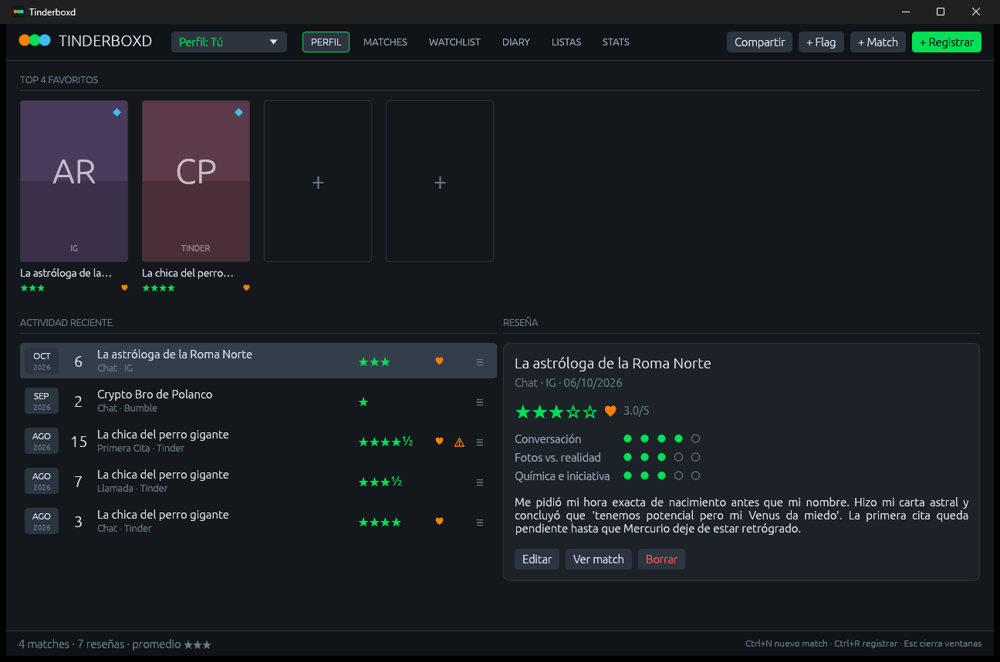
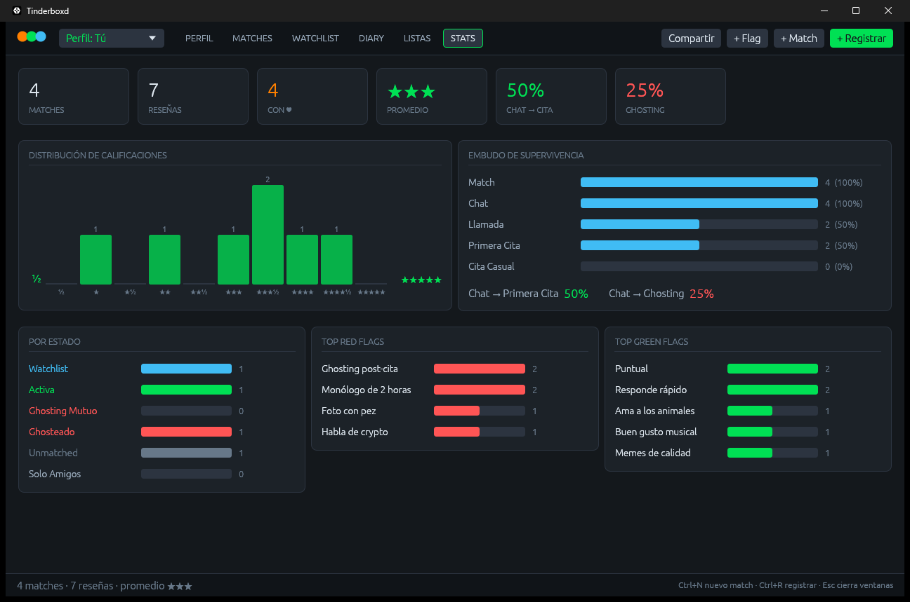
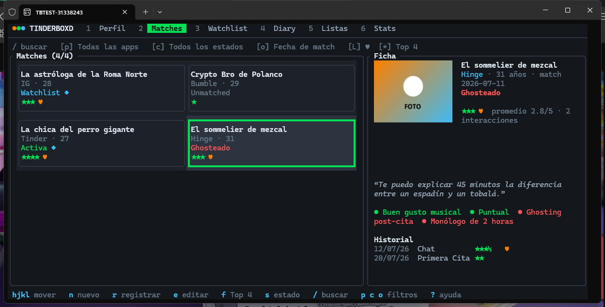
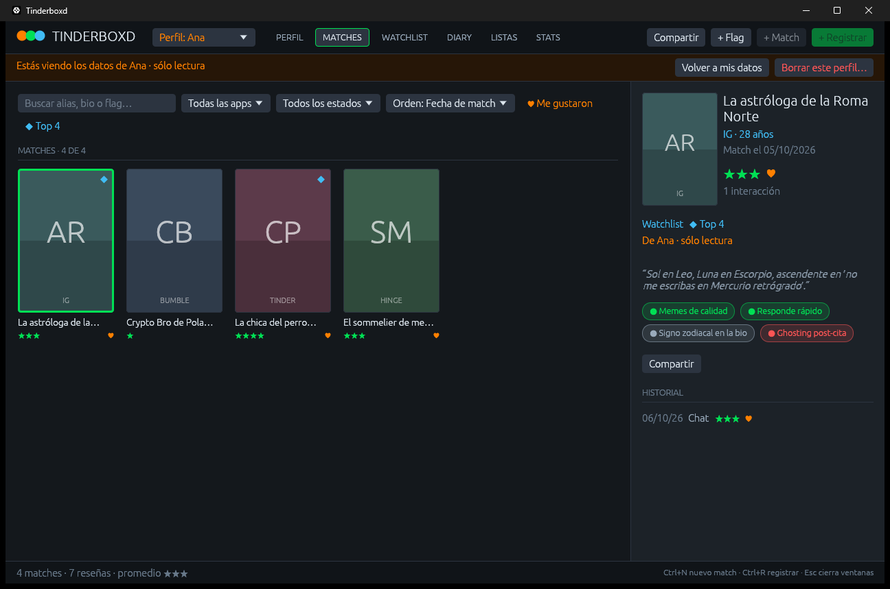

# Tinderboxd

**Tu Letterboxd de matches y citas.** Registra, califica y analiza tus matches de Tinder, Bumble, Hinge, Instagram o la vida real como si fueran películas: con estrellas, reseñas, un diario, listas y estadísticas.

Funciona como aplicación de escritorio y también en la terminal. Ambas comparten los mismos datos, que se guardan en tu equipo y no se envían a ningún servidor.



---

## Funcionalidades

- **Perfil.** Muestra tu Top 4 de favoritos y la actividad reciente, con la reseña completa al lado.
- **Matches.** Cuadrícula de pósters (con la foto de cada match o uno generado con sus iniciales). Se puede buscar y filtrar por app, estado, ♥ y Top 4, y ordenar de varias formas. Cada match tiene una ficha con su bio, flags e historial.
- **Watchlist.** La sala de espera: matches pendientes de primera cita o primer mensaje, con los días que llevan esperando.
- **Diary.** Todas tus interacciones (chat, llamada, primera cita, cita casual) en orden cronológico. Cada reseña lleva:
  - una calificación de ½ a 5 estrellas y un ♥ si te gustó;
  - tres sub-métricas: **conversación**, **fotos vs. realidad** y **química**;
  - un texto, que se puede marcar como *spoiler* para ocultarlo.
- **Listas.** Listas temáticas, con o sin ranking, y una nota para cada match (por ejemplo, "Citas que debieron quedarse en el chat").
- **Stats.** Distribución de calificaciones, embudo de supervivencia (cuántos pasan de chat a primera cita y cuántos acaban en ghosting), conteo por estado y top de *red flags* y *green flags*.
- **Flags.** Etiquetas 🚩 Red Flag, 🟢 Green Flag o Neutral que se asignan a cada match.
- **Fotos.** Se eligen desde la app y se guardan como copia junto a tus datos. En la terminal también se ven, si tu terminal soporta imágenes (ver [Terminal](#terminal-tui)).
- **Compartir con amigos.** Puedes exportar tus datos (todo, un match o una lista) a un archivo JSON, con fotos incluidas, e importar los de tus amigos. Cada amigo queda en **su propio perfil**, separado del tuyo y con sus propias estadísticas.



---

## Instalación

### Windows

En la sección de *releases* (o generándolos tú, ver [Crear los paquetes](#crear-los-paquetes)) hay dos opciones:

| Archivo | Para qué |
|---|---|
| `Tinderboxd_<versión>_x64-setup.exe` | **Instalador.** No pide permisos de administrador, crea accesos directos en el menú Inicio y el escritorio, y se desinstala desde "Agregar o quitar programas". Desinstalar no borra tus datos. |
| `Tinderboxd_<versión>_x64-portable.zip` | **Portable.** Descomprime la carpeta donde quieras (también en una USB) y abre `tinderboxd-gui.exe`. Tus datos se guardan en la carpeta `datos` de esa misma carpeta. |

Funciona en Windows 10 y 11 de 64 bits sin instalar nada más.

### Linux y macOS

Por ahora se compila desde el código (ver [Compilar desde el código](#compilar-desde-el-código)). En Linux la aplicación de escritorio necesita:
- una sesión gráfica (X11 o Wayland) y una GPU con Vulkan u OpenGL;
- `xdg-desktop-portal` para el botón "Elegir foto…", que viene en GNOME, KDE y la mayoría de escritorios.

---

## Uso

Hay dos ejecutables:

- **`tinderboxd-gui`**: la aplicación con ventana. Es la que abren los accesos directos.
- **`tinderboxd`**: la interfaz de terminal y la línea de comandos.

```sh
tinderboxd                      # interfaz de terminal (TUI)
tinderboxd --gui                # aplicación de escritorio (desde la terminal)
tinderboxd --resumen            # resumen de tus datos y estadísticas en la consola
tinderboxd --help               # todas las opciones
```

La primera vez se crean unos datos de ejemplo (cuatro matches ficticios con sus reseñas) para que puedas probar todo. Bórralos cuando quieras: no vuelven a aparecer.

### Aplicación de escritorio

Todo se hace con el ratón. También hay atajos:

| Atajo | Acción |
|---|---|
| `Ctrl+N` | Nuevo match |
| `Ctrl+R` | Registrar una interacción (reseña) |
| `Ctrl+1` … `Ctrl+6` | Cambiar de pestaña |
| `Ctrl+Enter` | Guardar el formulario abierto |
| `Esc` | Cerrar el formulario sin guardar |
| Doble clic | Editar un match o una reseña |

En macOS, usa `Cmd` en lugar de `Ctrl`.

### Terminal (TUI)



Pulsa `?` para ver todos los atajos dentro de la app.

| Teclas | Acción |
|---|---|
| `Tab` / `Shift+Tab` / `1`-`6` | Cambiar de pestaña |
| `h` `j` `k` `l` o flechas | Moverse (en Matches, por la cuadrícula) |
| `g` / `G` | Ir al inicio / al final |
| `n` | Nuevo match (en Listas: nueva lista) |
| `r` | Registrar una interacción del match seleccionado |
| `e` / `d` | Editar / borrar lo seleccionado |
| `f` | Añadir o quitar del Top 4 |
| `s` | Pasar al siguiente estado |
| `t` | Crear un flag |
| `/` | Buscar por alias, bio o flag |
| `p` · `c` · `o` | Filtrar por app · filtrar por estado · cambiar el orden |
| `L` · `*` · `x` | Sólo ♥ · sólo Top 4 · limpiar filtros |
| `v` | Mostrar u ocultar spoilers |
| `P` | Mostrar u ocultar fotos |
| `E` / `I` | Exportar a JSON / importar un JSON |
| `u` / `X` | Cambiar de perfil / borrar el perfil importado que estás viendo |
| `Enter` (Listas) | Entrar en los items: `J`/`K` reordenan, `x` quita, `a` añade |
| `q` | Salir |

En los formularios: `Tab` o `↑`/`↓` cambian de campo, `←`/`→` cambian el valor, `Espacio` marca, `Enter` guarda y `Esc` cancela.

**Fotos en la terminal:** en Windows Terminal 1.22 o superior, WezTerm, Kitty, iTerm2, foot y Konsole se ve la foto real. En otras terminales se dibuja con bloques de colores. Se recomienda Windows Terminal en Windows.

---

## Compartir con amigos

Exporta tus datos a un archivo JSON y pásaselo a quien quieras. Las fotos viajan dentro del archivo, salvo que uses `--sin-fotos`.

```sh
tinderboxd --exportar mis-citas.json                         # todos tus datos
tinderboxd --exportar lista.json --solo-lista "chat"         # una lista (id o parte del título)
tinderboxd --exportar match.json --solo-match "sommelier"    # un match (id o parte del alias)
```

Para cargar el archivo de un amigo en su propio perfil:

```sh
tinderboxd --importar de-ana.json --de Ana
```

- Los datos de Ana quedan **separados de los tuyos**: sus matches, listas, Top 4 y estadísticas no se mezclan con los tuyos.
- Son **de solo lectura**: sirven para ver y comparar. Puedes borrar el perfil entero cuando quieras.
- Reimportar el mismo archivo no duplica nada.
- Para cambiar de perfil: el selector **"Perfil: Tú ▾"** en la app, `u` en la terminal, o `--perfil Ana` / `--perfil todos` en la línea de comandos (por ejemplo, `tinderboxd --resumen --perfil Ana`).



**Respaldos:** `tinderboxd --exportar respaldo.json --perfil todos` guarda todo, incluidos los perfiles importados. Si luego lo importas sin `--de`, cada dato vuelve a su dueño. Así puedes pasar todo a otro equipo.

En la aplicación de escritorio, todo esto está en el menú **Compartir** y en los botones "Compartir" de cada match y lista.

---

## Dónde se guardan tus datos

La base de datos (`tinderboxd.db`) y la carpeta de fotos (`tinderboxd_fotos`) van juntas:

| Sistema | Carpeta |
|---|---|
| Windows | `%APPDATA%\tinderboxd\` |
| Linux | `~/.local/share/tinderboxd/` |
| macOS | `~/Library/Application Support/tinderboxd/` |
| Modo portable | `datos\`, junto a los ejecutables |

- El **modo portable** se activa si hay un archivo `portable.txt` junto a los ejecutables. El ZIP portable ya lo trae.
- Con `--db ruta/archivo.db` puedes usar cualquier otra base de datos.
- Las fotos se guardan con rutas relativas, así que puedes mover la carpeta entera sin perderlas.

---

## Compilar desde el código

Requisitos: **Rust 1.95 o superior** ([rustup.rs](https://rustup.rs)) y un compilador de C, porque SQLite se compila dentro del programa:
- Windows: *Build Tools* de Visual Studio, la instalación habitual de Rust.
- Linux: `gcc`.
- macOS: las *Command Line Tools* de Xcode.

```sh
cargo run                         # interfaz de terminal
cargo run -- --gui                # aplicación de escritorio
cargo run --bin tinderboxd-gui    # aplicación de escritorio sin consola
cargo test                        # pruebas
cargo install --path . --locked   # instala tinderboxd y tinderboxd-gui como comandos
```

### Crear los paquetes

En Windows, el instalador y el ZIP portable se generan con [cargo-packager](https://github.com/crabnebula-dev/cargo-packager), que descarga NSIS automáticamente:

```powershell
cargo install cargo-packager --locked
powershell -ExecutionPolicy Bypass -File scripts\empaquetar-windows.ps1
```

Los archivos quedan en `dist\`. El icono se regenera con `scripts\generar-icono.ps1`.

---

## Arquitectura

```
src/
├── lib.rs                  biblioteca compartida por los dos ejecutables
├── main.rs                 tinderboxd: línea de comandos (clap) y TUI
├── bin/tinderboxd-gui.rs   tinderboxd-gui: sólo la ventana, sin consola
├── core/                   la lógica, sin dependencias de interfaz
│   ├── models.rs           matches, reseñas, flags, listas, perfiles, estadísticas
│   ├── db.rs               SQLite: esquema, migraciones, consultas y fotos
│   ├── state.rs            estado compartido: pestañas, filtros, formularios
│   └── export.rs           exportar e importar JSON
├── tui/                    interfaz de terminal (ratatui)
└── gui/                    aplicación de escritorio (eframe/egui)
```

Las dos interfaces solo leen y modifican `AppState` y llaman a `Database`. Ningún archivo de `core/` depende de `egui` ni de `ratatui`. La especificación original del proyecto está en [AGENT.MD](AGENT.MD).

**Tecnologías:** Rust · SQLite (`rusqlite`) · `ratatui` + `crossterm` + `ratatui-image` · `eframe`/`egui` · `serde` · `clap`.
